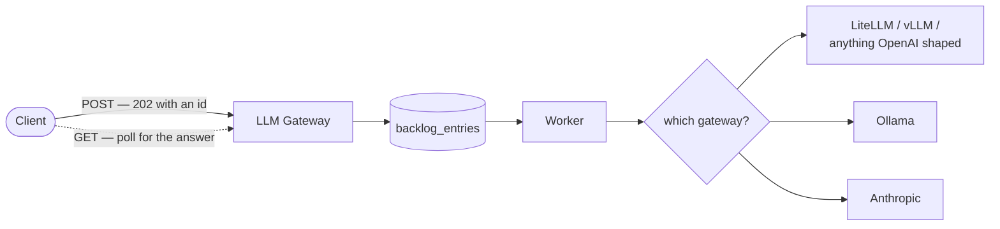
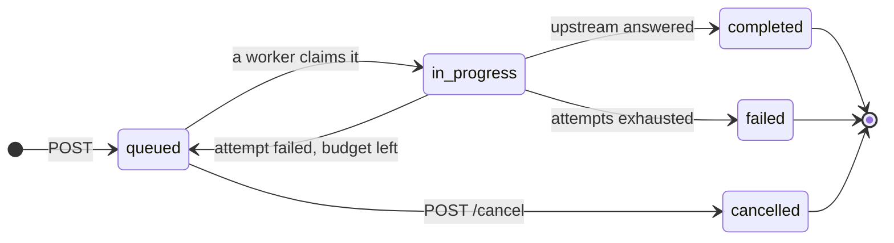
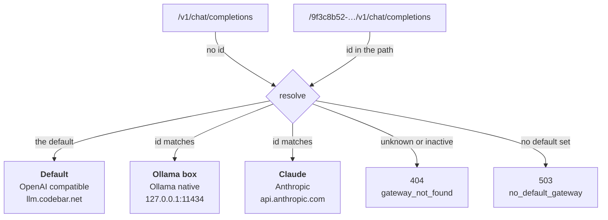
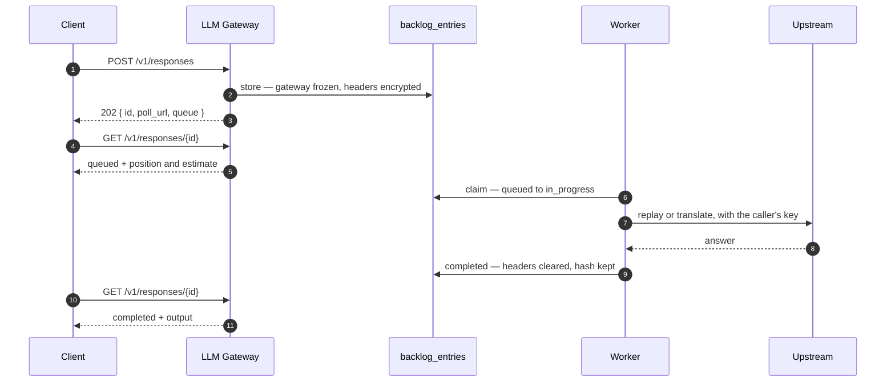

# LLM Gateway

[](LICENSE)


[](https://github.com/codebar-ag/llm-gateway.codebar.ai/actions/workflows/pest_pull_request.yml)
[](https://github.com/codebar-ag/llm-gateway.codebar.ai/actions/workflows/pint_pull_request.yml)
[](https://github.com/codebar-ag/llm-gateway.codebar.ai/actions/workflows/larastan_pull_request.yml)


An async-only queue in front of your LLM backends. Requests are stored as
backlog entries, processed one at a time by queue workers, and picked up later
through the OpenAI Responses API shape.



Which upstream a request lands on is a **gateway**: a row you manage in the
dashboard, addressed by putting its id in front of `/v1`. A request that names
none goes to the default. See [Gateways](#gateways).

It deliberately does **one** thing, and does it to **everything that costs
the backend compute**: chat completions, embeddings and moderations all queue,
all come back as a `202` with an id to poll, and all are run by the same
workers one at a time. A backend that can serve one request at a time has to
be asked one at a time — an endpoint that answers inline is an endpoint that
lets a caller hammer it, which is exactly how an indexing run firing tens of
thousands of embedding batches takes the backend down.

The only endpoints answered straight from the upstream are the ones that cost
it nothing to answer: `GET /v1/models` and `GET /v1/models/{id}`, cheap
idempotent reads that every SDK makes before it can do anything at all.

Because everything queues, everything is written down. The row exists from the
moment a request is *accepted*, before anything goes upstream, so a backend
that never answers is visible in the dashboard rather than silent. Filter by
endpoint, model, gateway or caller.

## The problem

Local models are cheap to run and expensive to run *at the same time*. A
single GPU — or a Mac's unified memory — realistically holds one or two
concurrent Ollama calls before context-switching between models starts
costing more than it saves; `OLLAMA_NUM_PARALLEL` exists precisely because
that ceiling is hard, not soft. Past it, requests queue up whether you built
a queue or not. The only choice is *where*: somewhere you can see it, or
inside Ollama's own scheduler, where a request that's merely waiting its turn
looks identical to one that's stuck.

LiteLLM already gives Ollama an OpenAI-compatible surface, including
`POST /v1/responses` with `background: true` — except that mode assumes a
backend that can hand back a job id and be polled later, and Ollama can't:
every call runs synchronously, and `GET /v1/responses/{id}` on top of it
answers *"GET responses is not supported for ollama_chat"*.

Hand-rolling that missing queue tends to trade one problem for three: a
worker that dies mid-call silently loses the job, a retry with no idempotency
window answers the same prompt twice, and a queue that isn't scoped per
caller lets one API key read back another's prompts. LLM Gateway is a queue
that closes those specifically — a dead worker's job is reclaimed rather than
dropped once its timeout passes (see [Installation](#installation)), retries
live on the entry so an answer is never computed twice (see
[Design notes](#design-notes)), and every entry is namespaced to the key that
created it (see [Ownership](#ownership)) — behind the exact API shape a
`background: true` call was already supposed to have, so nothing calling it
needs to know Ollama is on the other end at all.

## Where this comes from

This grew out of running local models day to day at
[Codebar](https://codebar.ch): rather than teach every internal tool to
serialize its own Ollama calls, we put one real queue in front of it and gave
it back the async API surface LiteLLM's `background: true` was supposed to
provide. This is that same tool, published as-is.

## Contents

- [The problem](#the-problem)
- [Where this comes from](#where-this-comes-from)
- [Endpoints](#endpoints)
- [Gateways](#gateways)
- [Ownership](#ownership)
- [Passthrough](#passthrough)
- [Dashboard](#dashboard)
- [Installation](#installation)
- [Usage](#usage)
- [Design notes](#design-notes)
- [Deployment](#deployment)
- [Development](#development)
- [Contributing](#contributing)
- [Security](#security)
- [License](#license)

## Endpoints

| Endpoint | Behaviour |
|---|---|
| `POST /v1/chat/completions` | queued — `202` with `id`, `poll_url` and `queue` |
| `POST /v1/responses` | queued — `202` in the Responses API shape, plus `queue` |
| `GET /v1/responses/{id}` | status, result and `queue` — your own entries only |
| `GET /v1/responses` | your recent entries; `?status=failed&model=…&limit=50` |
| `POST /v1/responses/{id}/cancel` | only while `queued`, otherwise `409` — works for **any** queued call |
| `DELETE /v1/responses/{id}` | remove the entry from the API; the row is kept. Any queued call |
| `GET /v1/models` | **synchronous** — the resolved gateway's models, OpenAI-list shaped |
| `GET /v1/models/{id}` | **synchronous** — `404` (`model_not_found`) if the gateway does not list it |
| `POST /v1/embeddings` | queued — `202` with `id`, `poll_url` and `queue` |
| `GET /v1/embeddings/{id}` | `202` while it waits, the OpenAI embeddings body once it is answered |
| `POST /v1/moderations` | queued — `202` with `id`, `poll_url` and `queue` |
| `GET /v1/moderations/{id}` | `202` while it waits, the OpenAI moderation body once it is answered |
| `GET /up` | liveness — `200` once the app boots |
| anything else under `/v1` | `404` with an async-only hint |

Statuses: `queued → in_progress → completed | failed`, plus `cancelled` for
entries stopped before a worker picked them up.



Cancelling is only offered while an entry is `queued`: a running Ollama request
cannot be stopped cleanly, so cancelling `in_progress` would promise something
this app cannot keep. Retries are the loop back to `queued` — they live on the
entry, not in the queue, which is why workers run with `--tries=1`.

### Knowing how long the wait is

Anything that reports a `queued` entry carries a `queue` block. It sits in a key
of its own so the Responses API fields around it stay exactly as an SDK expects:

```json
{
  "id": "resp_019...",
  "object": "response",
  "status": "queued",
  "model": "qwen3-vl:30b-a3b",
  "output": [],
  "queue": {
    "position": 3,
    "depth": 7,
    "workers": 2,
    "estimated_seconds": 84,
    "estimated_completion_at": 1785000084
  }
}
```

`position` counts the entry itself, so first in line is `1`. `depth` is the whole
backlog, not just your own entries. `estimated_seconds` runs through to *your*
answer rather than to the moment a worker picks the entry up — it is the number
worth showing a user who is waiting for a result.

The block is `null` for any entry that is no longer waiting, so `queue` flipping
to `null` is the same signal as `status` leaving `queued`. Polling a queued entry
also answers `Retry-After`, which is the only backoff hint the poll endpoint
gives — reads are deliberately unthrottled.

The estimate is a projection, not a promise. It is the median of how long recent
answers for the same model actually took, multiplied by how many rounds of work
sit in front of you at the configured `BACKLOG_WORKERS`. A model nobody has asked
yet borrows the median across all models, and a backlog that has answered nothing
at all falls back to `BACKLOG_ESTIMATE_DEFAULT_SECONDS`.

What it cannot see is a model swap. A request that forces Ollama to load a
different model takes far longer than one on a model already in RAM, and a median
over past answers has no way to know a swap is coming — so expect a queue with
several models interleaved to run longer than it says.

Every one of these also answers under a gateway id — `POST /{id}/v1/chat/completions`,
`GET /{id}/v1/responses/{entry}`, and so on — so an SDK configured with
`base_url = https://your-host/{id}/v1` queues *and* polls against one upstream.
See [Gateways](#gateways).

A ready-to-run [Bruno](https://www.usebruno.com) collection covering every
endpoint lives in [`docs/bruno`](docs/bruno) — open the folder to get the
request chaining and the `local`/`public` environments. For a single file to
import instead, [`docs/openapi.yaml`](docs/openapi.yaml) is the whole API as an
OpenAPI 3.0 document, which Bruno, Postman and Insomnia all read. See the
collection's [README](docs/bruno/README.md).

## Gateways

**A gateway is an upstream you registered.** It has a base URL, a protocol, its
own timeouts, and an id that doubles as the URL segment callers use to reach it:

```bash
# the default gateway
curl https://your-host/v1/chat/completions -d '…'

# one specific gateway
curl https://your-host/9f3c8b52-…/v1/chat/completions -d '…'
```

Exactly one gateway is the default at any time; requests without an id go
there. An unknown or deactivated id is a `404` (`gateway_not_found`), and if
nothing is the default the API says so with a `503` (`no_default_gateway`)
rather than guessing.



Manage them at `/gateways` in the dashboard, behind the same `DASHBOARD_TOKEN`
as everything else. Migrating an existing install needs no `.env` change: the
migration seeds your current `LITELLM_URL` as the default gateway.

| Protocol | Endpoint | Body |
|---|---|---|
| **OpenAI compatible** | `{base}/v1/chat/completions` | passed through untouched |
| **Anthropic** | `{base}/v1/messages` | translated out and back |
| **Ollama** | `{base}/api/chat` | translated out and back |

OpenAI-compatible covers LiteLLM, vLLM, OpenRouter, Groq, Azure and Ollama's
own OpenAI shim — anything already speaking that shape, including another LLM
Gateway. The other two are for talking to a backend directly.

**Credentials stay pass-through.** A gateway stores no key of its own; the
caller's `Authorization` is what authenticates upstream, as it always was. For
Anthropic that same token is moved into the `x-api-key` header the Messages API
expects, and `anthropic-version` defaults to `2023-06-01` unless you send one.

Three things to know before pointing a gateway at a native backend:

- **Tool calling is not translated.** OpenAI `tools`/`tool_calls` ↔ Anthropic
  `tool_use` is a mapping of its own and is not implemented; a `tool_use` reply
  normalises to an empty answer with `finish_reason: tool_calls`.
- **Images are dropped** on the Anthropic and Ollama routes. Multimodal content
  parts are flattened to their text, because those two carry images differently
  enough that guessing would be worse than a visibly missing image.
- **The dashboard shows the stored request, not the translated one.** The entry
  page says so on any non-passthrough gateway.

Each gateway may name a `default_model`, used only when the caller's request
names none — handy for a box that serves exactly one model. A request that
names a model is never overridden.

Retiring a gateway is a soft delete, so entries keep pointing at what answered
them. Deactivating one stops it taking *new* requests without stranding what is
already queued for it: an entry is bound to its gateway when it is accepted, so
moving the default never redirects an answer someone is already waiting for.

## Ownership

**An entry belongs to the key that queued it.** Read it back, cancel it or
delete it with the same `Authorization` you sent when you created it, and no
other key can see it exists — a mismatch is a `404`, not a `403`, so the API
never confirms an id it will not serve.

The gateway stores only a SHA-256 hash of your bearer token to make that check
(`api_key_hash`), never the token itself once the entry is final. Listing is
scoped the same way: `GET /v1/responses` returns your entries, not everyone's.

Queueing without a key still works — it is passed through and the upstream
rejects it, exactly as documented below — and such an entry is then owned by "no key",
readable by any request that likewise sends no `Authorization`. That shared
anonymous bucket is fine on a trusted network and a boundary drawn by "sent no
token" anywhere else, so set `API_REQUIRE_CALLER_KEY=true` and every `/v1`
route — reads included, not just the two POSTs — answers `401` until a caller
sends one. It still checks only that a key *was* sent; whether it is any good
stays the upstream's decision. Every keyed entry is already isolated, so this
changes nothing for callers that already send one.

## Passthrough

**The gateway holds no credentials and validates nothing.** There is no master
key, no shared secret, no user table, and no request validation. It takes what
you send, queues it, and the worker replays it upstream unchanged:

- **Headers** are stored and replayed exactly as they arrived, from a fixed
  allowlist: `Authorization`, `Content-Type`, `Accept`, `Accept-Language`,
  `User-Agent`, `X-Request-Id`, and anything prefixed `X-Litellm-`, `OpenAI-`
  or `Anthropic-`. Everything else is dropped rather than forwarded — a
  `Cookie` from a browser-originated call has no business reaching an upstream,
  and a denylist would have to be right about every header invented after it
  was written.
- **The body** goes upstream untouched. Unknown fields are not stripped, a
  missing `model` is not an error, `stream: true` is not refused.

```bash
curl https://your-host/v1/responses \
  -H "Authorization: Bearer $MY_API_KEY" \
  -H "X-Litellm-Tag: invoices" \
  -H "Content-Type: application/json" \
  -d '{"model":"qwen3-vl:30b-a3b","input":"Say PONG"}'
```

Because the upstream call happens long after the HTTP request is gone, the
headers are stored with the entry. They are encrypted at rest, never returned
by the API, never shown on the dashboard (only their *names* are), and cleared
the moment the entry reaches a final status. A SHA-256 hash of the bearer token
stays behind, so entries remain attributable — and readable only by their
owner — without keeping the secret.

The one thing the gateway does police is *how often* you queue, never *what*
you queue. `BACKLOG_RATE_LIMIT` (default 60/min) is counted per caller key —
per IP if you send none — because an entry costs a database row and a worker
slot before the upstream has seen it, and there are only ever a handful of workers.
Going over returns `429` with a `Retry-After` header; set it to `0` to lift the
limit entirely on a trusted network. Reading an answer back is never throttled,
since polling is the documented way to collect one.

Whether a key is any *good* is the upstream's decision, not ours. A wrong key —
or no key at all — is queued like everything else and then fails with the
upstream's own error stored verbatim: the same answer a direct call would have given, just
visible in the backlog. What the gateway does decide on its own is *whose*
entry is whose, because that question never reaches the upstream (see Ownership).

The one exception to passthrough on the caller's side is `POST /v1/responses`,
which is translated into a chat completion. That translation is the reason this
app exists, since LiteLLM cannot serve `/v1/responses` from an Ollama backend.
On the upstream side, gateways with the Anthropic or Ollama protocol translate
too — see [Gateways](#gateways). An OpenAI-compatible gateway, the default,
stays a pure passthrough.

Two consequences worth stating plainly: anyone who can reach the gateway can
create entries, so keep it on an internal network or behind your proxy's access
rules exactly as you would with the backend itself. And `stream: true` is passed
through, so the answer is stored as the raw stream rather than parsed text —
if you want streaming, call the backend directly.

## Dashboard

`GET /` renders a read-only dashboard — counts per status, the 100 most recent
entries per page, wait times, durations and error details, filtered by entry id,
endpoint, model, gateway or caller. Every call this app forwards is in there,
queued or not: an embedding shows up beside a completion, marked with the
endpoint it came in on. `GET /entries/{id}`
shows one entry in full: the request that went upstream (**including the whole
prompt, and for vision calls the base64 image**), the answer, the usage and the
names — never the values — of the forwarded headers.

Because that is the most sensitive view in the app, it is guarded twice: by an
operator **account**, and optionally by a shared **token** in front of it.
Neither is a caller key — a caller key buys a view of that caller's own entries
through `/v1`, while these grant a view of everyone's, so no caller key opens
the dashboard.

### Accounts

An account is always required. There is no registration route and **no web
password reset** — both are server commands, which is what keeps the dashboard
free of any unauthenticated route that could mint or recover access.

```bash
php artisan user:register                     # prompts for name and email
php artisan user:register --name=Ops --email=ops@example.com
```

**The password is generated, never chosen** — 16 characters from
`random_bytes()` — and printed once. Nothing stores it in readable form, so
copy it there and then. Passing a password in is deliberately not possible: it
would put a chooseable, shell-history-visible secret on the account that reads
every prompt this gateway has handled.

Forgotten it? Issue a new one:

```bash
php artisan user:reset-password --email=ops@example.com
```

That also **signs out every browser** currently logged in as that operator. The
dashboard routes carry `auth.session`, which ties each session to the password
hash it was opened with, so a rotated password locks the old holder out instead
of leaving them signed in indefinitely.

Failed logins are throttled at five per minute per address **and** IP. Only
failures count, so mistyping once and then getting it right is not punished.

### Token

`DASHBOARD_TOKEN` is a second, shared secret sitting *in front of* the login.

```bash
openssl rand -hex 32     # put the result in DASHBOARD_TOKEN
```

Open `https://your-host/?token=…` once. The token is swapped for an encrypted
cookie and stripped from the URL, so it stays out of your history, out of
`Referer` headers and out of the dashboard's own filter links. Scripts can send
it as `Authorization: Bearer …` instead.

It runs **before** the login, so a visitor without it is refused outright rather
than being shown a form that tells them an account is what gets them in. That
also means you present the token once per browser before you can reach the login
page at all.

Leave `DASHBOARD_TOKEN` empty and the login alone guards the dashboard. This
reverses earlier behaviour, where an empty token switched the dashboard off with
a `404` — that made sense while the token was the only guard, and no longer does
now that a session is required either way. The `/v1` API is unaffected by both.

## Installation

Requires PHP ≥ 8.5, Composer, Node ≥ 24, PostgreSQL and a reachable LLM backend.

The dashboard is built on `@codebar-ag/storybook`. **No credentials are needed
for anything here** — it is pinned as a git dependency on a public repository:

```json
"@codebar-ag/storybook": "github:codebar-ag/storybook.codebar.ch#v1.7.0"
```

A tag rather than a branch, so installs are reproducible, and the package's own
`prepare` script builds it after checkout. Upgrading means bumping that tag.

It is *published* to GitHub Packages too, but installing from there needs a token
for every read — public packages included, unlike npmjs.com — so the git route is
what this project uses instead. If you ever switch back, you will need an
`.npmrc` mapping the `@codebar-ag` scope and a `GITHUB_TOKEN` with
`read:packages`, locally and in CI.

```bash
composer install
cp .env.example .env         # fill in DB_*, GATEWAY_* and DASHBOARD_TOKEN
php artisan key:generate
createdb llm_gateway
php artisan migrate          # seeds GATEWAY_SEED_URL as the default gateway
npm run build                # installs the private package first if needed
```

`GATEWAY_SEED_URL` only seeds that first row. From then on, upstreams are
managed at `/gateways` — see [Gateways](#gateways).

Run it:

```bash
php artisan serve --port=8080
php artisan queue:work --queue=default --tries=1 --timeout=960
```

Run as many workers as the backend handles in parallel — with Ollama that is
`OLLAMA_NUM_PARALLEL`, usually 2. More workers only move the backlog from your
database into Ollama's own opaque queue, which is the problem this app solves.

There is no scheduler and no cron entry: the queue recovers itself. When a
worker dies mid-call its job stays reserved, and once `retry_after` has passed
another worker reclaims it, finds the attempt budget spent, and the entry lands
in `failed` with its error — the same path a normal failure takes.

That only holds while **`retry_after` is longer than the job's own timeout**. It
is derived from `GATEWAY_MAX_TIMEOUT` in `config/queue.php` so the two cannot
drift apart, and a test asserts the margin. Set it shorter and the queue starts
handing still-running calls to a second worker, and the model answers the same
prompt twice.

This is also why `GATEWAY_MAX_TIMEOUT` is a *ceiling* rather than a timeout.
Each gateway sets its own timeout for the upstream call, but `retry_after` is
one value for the whole queue connection, so no gateway may be given a timeout
above the ceiling — the form refuses it. Raise the ceiling first, then the
gateway.

Nothing is ever deleted. `DELETE /v1/responses/{id}` soft-deletes, so the entry
leaves the API and the dashboard while the row — prompt, answer and all — stays
as history.

## Usage

```bash
ID=$(curl -s https://your-host/v1/responses \
  -H "Authorization: Bearer $MY_API_KEY" \
  -H "Content-Type: application/json" \
  -d '{"model":"qwen3-vl:30b-a3b","input":"Say PONG"}' | jq -r .id)

curl -s https://your-host/v1/responses/$ID \
  -H "Authorization: Bearer $MY_API_KEY" | jq .status
```

Queue, then poll — the HTTP request that created the entry is long gone by the
time the model answers, which is why the caller's headers travel with it:



Vision input follows the Responses API format:

```json
{
  "model": "qwen3-vl:30b-a3b",
  "priority": 10,
  "input": [{"role": "user", "content": [
    {"type": "input_text", "text": "Extract invoice number and total as JSON."},
    {"type": "input_image", "image_url": "data:image/png;base64,…"}
  ]}]
}
```

The answer lands in `output[0].content[0].text`.

## Design notes

- **Retries live on the entry, not in the queue** — hence `--tries=1` for
  workers. Attempt counter, result and error stay in one row.
- **No streaming** — streaming and a backlog contradict each other.
- **Cancel only while `queued`** — a running Ollama request cannot be stopped
  cleanly, so cancelling `in_progress` would promise something we can't keep.
- **Reasoning models** — the answer falls back to `reasoning_content` and
  strips `<think>` blocks; otherwise Qwen3-style models return empty text.
- **History is kept forever** — `DELETE` only soft-deletes, and there is no pruning. The backlog *is* the archive.
- **There is always exactly one *usable* default gateway** — routing reads
  `is_default` *and* `is_active`, so a default that has stopped taking work
  answers `503` to every request that arrives without a gateway id. Retiring the
  default is refused, deactivating it is refused, and promoting a gateway
  activates it. Move the flag first, then deactivate.
- **Upstream calls do not follow redirects** — a `base_url` is the address an
  operator reviewed, and a `302` would quietly make it a different one.

## Deployment

`deploy/` holds what the machine needs, so the setup lives in the repo instead
of in someone's shell history. Replace the placeholder paths, then load the
agents:

```bash
cp deploy/ch.codebar.llmgateway-*.plist ~/Library/LaunchAgents/
launchctl bootstrap gui/$(id -u) ~/Library/LaunchAgents/ch.codebar.llmgateway-worker.plist
launchctl bootstrap gui/$(id -u) ~/Library/LaunchAgents/ch.codebar.llmgateway-tunnel.plist
```

Check the php path with `which php` first — under Laravel Herd it is not
`/opt/homebrew/bin/php`. Copy the worker plist once per worker, with a
different `Label` and log paths.

### Public access

`deploy/cloudflared/config.yml` exposes the app through a Cloudflare Tunnel:
an outbound connection, so no port forwarding and no inbound firewall rule. It
points straight at the local web server — no extra reverse proxy in between,
which means the ingress rules are the only perimeter and are written as a
default deny:

| Rule | Paths | Reachable |
|---|---|---|
| API | `/v1/…`, `/{gateway}/v1/…`, `/up` | yes — callers bring their own key |
| Dashboard | `/`, `/login`, `/entries/…`, `/gateways…`, `/build/…`, `/favicon.*` | yes — but a login is required |
| everything else | `/storage/…`, `/index.php`, … | `404` before it reaches the origin |

Delete the dashboard rule to keep it on the LAN only; the API keeps working and
the token guard remains as the local-network guard. For a second factor in
front of the token, add a Cloudflare Access policy on the hostname under Zero
Trust → Access → Applications.

Behind Herd, the public hostname has to be rewritten to the local site name,
otherwise nginx serves its default site:

```yaml
originRequest:
  httpHostHeader: llm-gateway.codebar.test
```

Two things worth knowing. Cloudflare cuts responses off after 100 seconds
(error 524) on every plan below Enterprise — irrelevant here, because queueing
answers in milliseconds and polling is fast, but fatal for synchronous LLM
calls. And Herd is a development environment: on a machine that has to come
back on its own after a reboot, run the app under FrankenPHP or Octane and
install the tunnel as a system daemon with `sudo cloudflared service install`.

Set `TUNNEL_METRICS_URL` to cloudflared's metrics address and the dashboard
will report whether the tunnel is connected. Leave it empty and the indicator
reads `unknown`; a tunnel that is down never breaks the app.

### Worked example: macOS + Herd + Cloudflare Tunnel

The section above describes the general shape; this is the same setup as an
ordered, copy-pasteable walkthrough, for a Mac running Laravel Herd with a
remote LiteLLM instance as the default gateway, behind a Cloudflare Tunnel.
Replace `your-app`, `your-app.test`, `litellm.internal.example` and
`llm.your-domain.com` with your own values throughout.

- **PHP / Composer / Node / `psql`** come from Herd, not Homebrew.
- **The Herd site is secured**, so port 80 answers `301 → https://…test`. The
  tunnel must therefore point at `https://127.0.0.1:443`, not port 80 — see
  below.
- **The upstream can be remote.** A gateway's timeout — and the
  `GATEWAY_MAX_TIMEOUT` ceiling above it — still has to exceed the slowest
  model response, because the worker holds the HTTP call open the whole time.

#### 1. The application

Herd already provides `php`, `composer`, `node` and `psql`, and a parked
directory gets a `.test` site automatically:

```bash
cd ~/Projects/your-app

composer install
npm run build                # installs the private package first if needed

cp .env.example .env          # skip if .env already exists
php artisan key:generate
```

Fill in `.env`:

```dotenv
APP_URL=https://your-app.test

DB_CONNECTION=pgsql
DB_HOST=127.0.0.1
DB_PORT=5432
DB_DATABASE=llm_gateway
DB_USERNAME=postgres          # Herd's Postgres superuser, not your macOS user
DB_PASSWORD=

GATEWAY_SEED_URL=https://litellm.internal.example   # seeds the default gateway
GATEWAY_MAX_TIMEOUT=900                             # ceiling for any gateway

BACKLOG_QUEUE=default
BACKLOG_WORKERS=2
BACKLOG_RATE_LIMIT=60
BACKLOG_ESTIMATE_DEFAULT_SECONDS=30                 # assumed wait before anything
                                                    # has been answered

DASHBOARD_TOKEN=              # openssl rand -hex 32 — see step 4
TUNNEL_METRICS_URL=http://127.0.0.1:20241
```

Create the database and migrate:

```bash
createdb -U postgres llm_gateway
php artisan migrate
```

Check it:

```bash
curl -k https://your-app.test/up      # expect 200
```

If that 404s, the site is not being served — `herd park ~/Projects` from that
directory, or `herd link`.

#### 2. The queue worker

**Nothing works without a worker.** The API accepts and queues; a worker is
what actually calls the upstream. A dispatched job with no worker is a silent black
hole — the entry sits in `queued` forever and the caller polls forever.

For a terminal session:

```bash
php artisan queue:work --queue=default --tries=1 --timeout=960
```

To keep it running, use the launchd agent in `deploy/`. **Edit the paths
first** — the template ships with placeholders, and the PHP path is Herd's, not
Homebrew's:

```xml
<string>/Users/YOU/Library/Application Support/Herd/bin/php</string>
<string>artisan</string>
<string>queue:work</string>
...
<key>WorkingDirectory</key>
<string>/Users/YOU/Projects/your-app</string>
```

The space in `Application Support` is fine inside a plist `<string>`; it would
not be fine unquoted in a shell script.

```bash
cp deploy/ch.codebar.llmgateway-worker.plist ~/Library/LaunchAgents/
launchctl bootstrap gui/$(id -u) ~/Library/LaunchAgents/ch.codebar.llmgateway-worker.plist
launchctl print gui/$(id -u)/ch.codebar.llmgateway-worker | head -20
```

Run one worker per concurrent call you want. Copy the plist with a different
`Label` and log paths for a second. Keep the count in step with
`BACKLOG_WORKERS` — that value spawns nothing, it is what the dashboard reports
and what queue estimates divide the backlog by, so a wrong number quietly makes
every wait a caller is quoted wrong too.

After changing code: `php artisan queue:restart`.

**There is no scheduler and no cron entry.** Nothing is scheduled; the queue
recovers crashed workers by itself. If you previously had `schedule:run` in
`crontab`, remove it.

#### 3. The Cloudflare Tunnel

Install `cloudflared` if it isn't already:

```bash
brew install cloudflared
cloudflared --version
```

Authenticate and create the tunnel (once):

```bash
cloudflared tunnel login                       # opens a browser
cloudflared tunnel create llm-async
cloudflared tunnel route dns llm-async llm.your-domain.com
```

`create` writes a credentials file to `~/.cloudflared/<TUNNEL-ID>.json`. **It
never goes in the repo.**

Copy the config and fill in the placeholders:

```bash
mkdir -p ~/.cloudflared
cp deploy/cloudflared/config.yml ~/.cloudflared/config.yml
```

In `~/.cloudflared/config.yml` set:

- `credentials-file:` → the real path printed by `tunnel create`
- `hostname:` → your real public hostname, in **both** ingress rules

Everything else is already correct for a secured Herd site and is worth
understanding rather than editing:

```yaml
service: https://127.0.0.1:443
originRequest:
  httpHostHeader: your-app.test
  originServerName: your-app.test
  noTLSVerify: true
```

- **`:443`, not `:80`.** A secured site answers port 80 with `301 →
  https://your-app.test/…`. A visitor from the internet cannot resolve a
  `.test` name, so pointing the tunnel at port 80 sends every caller to a dead
  redirect. If you ever run `herd unsecure your-app`, switch to
  `service: http://127.0.0.1:80` and drop the two TLS lines.
- **`httpHostHeader`** rewrites the public name to the local site name, or Herd
  serves its default site instead of this app.
- **`noTLSVerify`** because the certificate is Herd's own and `cloudflared`
  does not trust it. The connection never leaves the loopback interface.

The ingress is **default deny** — three rules, evaluated top to bottom:

| Rule | Paths | Reachable |
|---|---|---|
| API | `/v1/…`, `/{gateway}/v1/…`, `/up` | yes — callers bring their own key |
| Dashboard | `/`, `/login`, `/entries/…`, `/gateways…`, `/build/…`, `/favicon.*` | yes, but a login is required |
| everything else | `/storage/…`, `/index.php`, … | `404` before it reaches the origin |

Delete the dashboard rule to keep it on the LAN only. For a second factor in
front of the token, add a Cloudflare Access policy on the hostname under Zero
Trust → Access → Applications.

Run it:

```bash
cloudflared tunnel run llm-async                  # foreground, to test
```

Then install the agent:

```bash
cp deploy/ch.codebar.llmgateway-tunnel.plist ~/Library/LaunchAgents/
# edit the --config path inside it first
launchctl bootstrap gui/$(id -u) ~/Library/LaunchAgents/ch.codebar.llmgateway-tunnel.plist
```

Set `TUNNEL_METRICS_URL=http://127.0.0.1:20241` in `.env` and the dashboard
shows a live tunnel indicator. Leave it empty and the badge reads `unknown`; a
tunnel that is down never breaks the app.

#### 4. The dashboard token

`GET /` and `GET /entries/{id}` render whole prompts and answers, so they are
not public. Generate a token and put it in `.env`:

```bash
openssl rand -hex 32
```

```dotenv
DASHBOARD_TOKEN=<the value>
```

Open `https://llm.your-domain.com/?token=<the value>` **once**. The token is
swapped for an encrypted cookie and stripped from the URL, so it stays out of
your history and out of `Referer` headers. Scripts can send it as
`Authorization: Bearer <token>` instead.

Then create the account you will actually log in with:

```bash
php artisan user:register
```

Leave `DASHBOARD_TOKEN` empty and the login alone guards the dashboard. The
`/v1` API is unaffected either way.

Both are **operator** credentials: together they show every entry from every
caller. They are deliberately not the same thing as the caller keys the API
replays, which only ever see their own entries.

#### 5. Verify end to end

```bash
HOST=https://llm.your-domain.com
KEY=$MY_API_KEY

# queue one
ID=$(curl -s $HOST/v1/responses \
  -H "Authorization: Bearer $KEY" \
  -H "Content-Type: application/json" \
  -d '{"model":"qwen3-vl:30b-a3b","input":"Say PONG"}' | jq -r .id)

# poll it — same key, or you get a 404
curl -s $HOST/v1/responses/$ID -H "Authorization: Bearer $KEY" | jq .status
curl -s $HOST/v1/responses/$ID -H "Authorization: Bearer $KEY" \
  | jq -r '.output[0].content[0].text'
```

Expected: `202` with an id, `queued` → `in_progress` → `completed`.

Quick checks:

```bash
curl -s -o /dev/null -w '%{http_code}\n' $HOST/up                     # 200
curl -s -o /dev/null -w '%{http_code}\n' $HOST/                       # 403 without token
curl -s -o /dev/null -w '%{http_code}\n' $HOST/gateways              # 403 without token
curl -s -o /dev/null -w '%{http_code}\n' $HOST/storage/x              # 404 at the edge
php artisan tinker --execute='echo App\Models\BacklogEntry::count();'
```

#### Troubleshooting

**Entries stay `queued` forever.** No worker is running. `launchctl print
gui/$(id -u)/ch.codebar.llmgateway-worker`, and check
`storage/logs/worker.err.log`.

**Everything 502s through the tunnel, but works locally.** The origin is
wrong. Confirm the site is secured and the tunnel points at `:443`:

```bash
curl -s -o /dev/null -w 'port 80  -> %{http_code}\n' -H 'Host: your-app.test' http://127.0.0.1/up
curl -sk -o /dev/null -w 'port 443 -> %{http_code}\n' -H 'Host: your-app.test' https://127.0.0.1/up
```

`301` then `200` means the config above is right. `200` on port 80 means the
site is unsecured — switch the tunnel back to `http://127.0.0.1:80`.

**A public request redirects to `your-app.test`.** The tunnel is pointing at
port 80 against a secured site. See above.

**You land on someone else's Herd site.** `httpHostHeader` is missing or does
not match the local site name.

**Dashboard answers 403.** `DASHBOARD_TOKEN` is set and yours is missing or
wrong. Re-open with `?token=…`.

**Dashboard sends you to `/login` and you have no account.** Run
`php artisan user:register` on the server. There is no reset link by design.

**`/login` itself answers 403.** The token guard runs before the login, so you
have to present `?token=…` once before the form is reachable at all.

**`GET /v1/responses/{id}` returns 404 for an entry you just created.** You are
polling with a different key than you queued with. Entries belong to the key
that created them, and a mismatch is a `404` on purpose — the API never
confirms an id it will not serve.

**Cloudflare 524 after 100 seconds.** Cloudflare cuts responses at 100 s on
every plan below Enterprise. Irrelevant here, because queueing answers in
milliseconds and polling is fast — but fatal if you ever try to proxy a
synchronous LLM call through the same tunnel.

**Duplicate answers to the same prompt.** `retry_after` must exceed the job
timeout, or the queue hands a still-running call to a second worker. It is
derived from `GATEWAY_MAX_TIMEOUT` in `config/queue.php` and a test asserts the
margin, so this should not happen — but if you hand-edit either value, run
`composer test` before trusting it.

**A request 404s with `gateway_not_found`.** The id in front of `/v1` is not a
gateway, or the gateway is deactivated. Check `/gateways`.

**A request 503s with `no_default_gateway`.** Nothing is flagged as the
default. Set one at `/gateways`; only the default serves requests that carry no
id.

### Operations

```bash
composer verify        # Pint, PHPStan level 10, Pest
php artisan queue:restart
tail -f storage/logs/laravel-$(date +%Y-%m-%d).log
```

Logs rotate daily and keep `LOG_DAILY_DAYS` (default 30) files.

Herd is a development environment. If a machine has to come back on its own
after a reboot without anyone logging in, run the app under FrankenPHP or
Octane and install the tunnel as a system daemon with `sudo cloudflared
service install` instead of the user agent above.

## Development

```bash
composer test     # Pest
composer lint     # Pint
composer analyse  # PHPStan level 10
composer verify    # all three
```

The frontend has one check of its own:

```bash
npm run lint:props   # every design-system prop against its own type definition
```

Vue renders an unknown prop as a plain HTML attribute on the component's root
element, so a typo binds nothing and still builds, still passes the PHP suite,
and still renders — just without the value. Two such bugs shipped during the
Inertia migration before this existed. It reads the props from the installed
package's `index.d.ts`, so it tracks upgrades rather than a copy that drifts,
and CI runs it before the build.

## Contributing

Bug reports, feature requests and pull requests are welcome — see
[CONTRIBUTING.md](CONTRIBUTING.md) for the workflow, coding standards and how
this project is tested.

## Security

Please **do not** open a public issue for a security vulnerability. See
[SECURITY.md](SECURITY.md) for how to report one privately.

## License

Licensed under the [MIT license](LICENSE).
